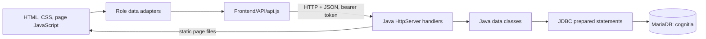

# Cognitia LMS

Cognitia is a browser-based learning management system for administrators, professors, and students. Its current stack is a static HTML/CSS/JavaScript frontend, a Java 21 HTTP API, and a MariaDB database managed locally through XAMPP.

This README is a project overview, setup guide, and defense outline. It describes the code that is present now and separates it from work that is planned or still needs verification.

## Project status

**The backend is implemented and has a Java smoke-test program. Frontend-to-backend integration is in progress, not complete.** The frontend migration note estimates that roughly 80% of backend-owned data workflows are connected to the API. This is a rough planning estimate, not a measured completion metric.

The project owner reported that all 15 backend smoke tests passed against their running server and database. That establishes that those tested API scenarios worked in that environment; it does not prove every endpoint, UI workflow, security edge case, or deployment scenario works. The recently connected admin, professor, student, and calendar screens still need end-to-end verification against MariaDB.

## Project layout

```text
Cognitia/
├── Backend/
│   ├── rcs/                 Java source and the database schema
│   │   ├── Main.java
│   │   ├── handlers/        HTTP route handlers
│   │   ├── data/            SQL and record access
│   │   ├── util/            JDBC, JSON, auth, password, and reply helpers
│   │   └── schema.sql       Current database schema (source of truth)
│   ├── lib/                 MariaDB JDBC driver
│   ├── build/               Compiled classes (generated)
│   ├── start.bat            Compile and run the backend
│   ├── runtest.bat          Compile and run backend smoke tests
│   └── BackendSmokeTest.java
├── Frontend/
│   ├── API/                 Shared API gateway, role data adapters, notes
│   ├── js/                  Page behavior and UI logic
│   ├── styles/              Presentation and responsive styles
│   └── *.html               Login, registration, and role pages
├── Documentation/
│   └── reference/           Supplied plans and historical inventory
└── README.md
```

The reference folder contains copies of the supplied `BACKEND-PLAN.md`, `API-CONTRACT.md`, `SCHEMA-NOTES.md`, and `DATA-INVENTORY.md` so the team can review them alongside the source. The data inventory describes the earlier localStorage-based frontend and is historical context; it is not a description of the migrated frontend today. The executable schema is [Backend/rcs/schema.sql](Backend/rcs/schema.sql). It currently creates **21 tables**; the plan's “23 tables” count should be treated as outdated unless the schema changes.

## Architecture and data flow



1. The browser opens the frontend through the Java server at `http://localhost:8000`.
2. Page code uses a role adapter (`admin-data.js`, `professor-data.js`, or `student-data.js`) to map API records into the existing screen's in-memory shape.
3. `API/api.js` is the shared HTTP/JSON gateway. It adds the bearer token, unwraps success/error replies, and stores the API token in tab-scoped `sessionStorage`.
4. Java handlers authenticate the request, check role and record ownership, validate input, and call the data classes.
5. Data classes use JDBC and parameterized SQL to read/write MariaDB. MariaDB constraints provide an additional layer for uniqueness and relationships.
6. The API response updates the page's in-memory view. Shared academic records are not kept as a localStorage shadow copy.

The actual frontend migration uses explicit role adapters and direct API operations for actions such as submissions, quiz attempts, and approvals. The older plan describes a generalized state diff/snapshot flow; do not describe that plan as the exact current implementation.

## Main feature areas

- **Authentication and accounts:** student and professor registration (both pending approval), login/logout, role-specific session checks, admin approval, user/profile management. Admin accounts are not publicly self-registered.
- **Academic setup:** programs, sections, courses, course/program relationships, and professor teaching assignments.
- **Learning content:** lessons and lesson files, assignments and attachments, quizzes and questions.
- **Student activity:** lesson completion, assignment submissions, quiz attempts, and answer feedback.
- **Teaching and grading:** professor content management, submission grading, essay grading, and calculated course grade views.
- **Announcements:** admin announcement management, audience visibility, scheduling, and per-user read marks.
- **Activity log:** admin view of recent server-recorded administrative actions.

Professor registration creates a pending account only. After approval, an administrator still needs to assign the professor to the appropriate courses and sections before the account can teach them.

## Data ownership and storage

MariaDB is the durable source of shared account and academic data. The backend schema has relational tables and link tables for programs, courses, sections, teaching assignments, content visibility, submissions, attempts, and reads. Grades are calculated when requested rather than stored in a separate grades table.

The frontend retains fetched records in memory for rendering and sends changes to the API. Browser storage remains for presentation/session concerns: theme, sidebar state, terms-read status, API token and safe session profile in `sessionStorage`, and student calendar personal events/tick/removal choices. The contract has no API endpoints for personal calendar events or assignment/quiz calendar ticks, so those choices do not sync across devices.

Old browser profiles can still have values under the legacy keys `cognitia_state`, `cognitia_student_data`, or `cognitia_prof_data`. The current migrated pages ignore them. They are not automatically imported into MariaDB or automatically deleted. The browser-generated student number counter was removed; the backend supplies student numbers.

## Local setup and run

### Requirements

- Windows for the supplied batch launchers.
- JDK 21 (the launcher compiles sources with `javac --release 21`).
- XAMPP MariaDB running locally.
- The MariaDB JDBC driver already included under `Backend/lib/`.

### First-time database setup

1. Start **MySQL/MariaDB** in the XAMPP Control Panel.
2. Import [Backend/rcs/schema.sql](Backend/rcs/schema.sql) through phpMyAdmin or the MariaDB client. It creates and selects the `cognitia` database.
3. Check the database connection settings in `Backend/rcs/util/Database.java`. The current defaults are `localhost:3306`, database `cognitia`, user `root`, and an empty password. Change the Java settings if the local XAMPP credentials differ, then rebuild with `start.bat`.

### Start the application

1. Keep MariaDB running.
2. Double-click `Backend/start.bat`.
3. The script compiles the Java backend and starts it on port `8000`. The server also serves the frontend files.
4. Open [http://localhost:8000/login.html](http://localhost:8000/login.html).

The backend calls its first-admin setup during startup and needs database access at that point. If MariaDB is offline or the schema has not been imported, the backend will not start successfully. The local bootstrap account currently used by the smoke test is `admin@cognitia.edu` / `admin123`; use it only for local development and change or remove it before any shared deployment.

To run the Java API smoke tests, leave the backend running and double-click `Backend/runtest.bat`. It compiles `Backend/BackendSmokeTest.java` and runs its hard-coded checks against `http://localhost:8000`. An alternate base URL can be passed as the batch file's first argument. The test requires MariaDB and the bootstrap admin, and it may create temporary test records; review the test source and database before running it against non-test data.

## API overview

API base path: `/api`. Responses use `{ "ok": true, "data": ... }` on success or `{ "ok": false, "error": "..." }` on failure. Authenticated calls send `Authorization: Bearer <token>`.

| Area | Main routes | Access summary |
|---|---|---|
| Authentication | `/login`, `/register`, `/logout`, `/me` | Login/registration public; remaining routes require a session |
| Users | `/users` and `/users/{id}` | Admin management; limited professor student listing; own-profile updates |
| Academics | `/programs`, `/sections`, `/courses` | Public reads where the contract allows; admin writes; professor/student course scope is restricted |
| Announcements | `/announcements`, `/announcements/{id}/read` | Admin manages; signed-in users see permitted audiences and can mark reads |
| Lessons | `/lessons`, `/lessons/{id}/file`, `/lessons/{id}/done` | Professor ownership and student section access are checked |
| Assignments | `/assignments`, submissions and grading routes | Professor ownership and student section/record ownership are checked |
| Quizzes | `/quizzes`, attempts and grading routes | Student views omit answer keys/rubrics; server scores objective responses |
| Grades | `/grades?courseId={id}` | Professor's taught courses or student's own course grade view |
| Activity | `/activity` | Admin only; server records applicable actions |

Consult [Documentation/reference/API-CONTRACT.md](Documentation/reference/API-CONTRACT.md) for request/response fields and the detailed route contract.

## Integration progress

| Area | Current state |
|---|---|
| Login, student/professor registration, logout, session | API-connected; student and professor applications await admin approval; admin accounts are not publicly self-registered |
| Admin account approval and management | API-connected; workflow still needs full UI verification |
| Professor content, submissions, attempts, and grading | API-connected through the professor adapter; workflow verification pending |
| Student courses, lessons, submissions, quizzes, grades, and announcements | API-connected through the student adapter; workflow verification pending |
| Announcement readers and admin activity log | API-connected |
| Student and professor calendar academic data | API-connected; personal events/tick/removal state remains local |
| Admin announcement calendar | Reads the admin page's API-loaded in-memory state |
| Full cross-role end-to-end integration | **Not yet verified; do not call the frontend/backend integration complete** |

The next integration phase is systematic end-to-end verification with the backend and database running: admin setup/approval, professor content creation and grading, student access/submission/quiz completion, announcements/read marks, and calendar dates. Record observed results and resolve mismatches before declaring completion. See [Frontend/API/FRONTEND-DATA-TRANSITION-NOTES.md](Frontend/API/FRONTEND-DATA-TRANSITION-NOTES.md) for current per-file notes and known mapping constraints.

## Known limitations and decisions

- **Local-only calendar choices:** personal events and assignment/quiz completion ticks are not part of the current backend contract and are stored only in this browser.
- **Session lifetime:** API tokens are random and held in server memory; there is no expiry. Restarting the Java server logs everyone out.
- **Transport/security:** local development uses plain HTTP. Use HTTPS and appropriate deployment security before exposing the application beyond a trusted local network.
- **Database configuration:** credentials are currently hard-coded in `Database.java`; externalize secrets before deployment.
- **Connection handling:** the implementation opens database connections per operation; it does not use a connection pool.
- **Concurrent edits:** there is no versioning or merge mechanism; later writes can overwrite earlier edits.
- **Multi-record frontend saves:** some admin saves make several API calls in sequence. If a later call fails, earlier calls may already have committed and cannot be rolled back as one cross-request transaction.
- **Course grades:** `/api/grades` calculates category averages from graded assignments and quiz attempts; it does not store a grade row. Confirm the formula and grading weights with the instructor before presenting it as a formal institutional policy.
- **File storage:** lesson, assignment, and submission file payloads are stored in MariaDB blobs. Set operational file limits and storage policies before production use.
- **Legacy browser data:** old localStorage records are ignored, not imported or purged automatically.
- **Verification scope:** a passing smoke test checks only its listed cases. It is not proof of complete integration, production security, load handling, or accessibility.

## Suggested defense walkthrough

1. **Problem and users:** introduce the admin, professor, and student roles and the learning workflows Cognitia supports.
2. **Architecture:** explain the browser → API gateway/adapters → Java handlers → data classes/JDBC → MariaDB path.
3. **Database design:** show how IDs and link tables represent relationships, and why derived course grades are calculated rather than duplicated in a grades table.
4. **Security responsibilities:** explain server-side authentication/role/ownership checks, salted password hashing, prepared statements, and why frontend button visibility is not authorization.
5. **Workflow demonstration:** show one end-to-end path such as admin approval, professor posting an assignment, student submitting, professor grading, and student viewing the grade.
6. **Testing evidence:** report the 15 backend smoke-test cases as environment-specific evidence; separately report which full frontend workflows have and have not been verified.
7. **Honest limitations and next steps:** mention in-memory tokens, local-only calendar choices, unverified role workflows, and what would change for deployment.

## Documentation references

- [Backend plan](Documentation/reference/BACKEND-PLAN.md) — intended backend structure and design rationale.
- [API contract](Documentation/reference/API-CONTRACT.md) — endpoint roles, payloads, and response expectations.
- [Schema notes](Documentation/reference/SCHEMA-NOTES.md) — plain-language table responsibilities and intentional omissions.
- [Data inventory](Documentation/reference/DATA-INVENTORY.md) — historical frontend data inventory from before API migration.
- [Frontend transition notes](Frontend/API/FRONTEND-DATA-TRANSITION-NOTES.md) — implemented frontend data changes, constraints, and remaining verification.
- [Current SQL schema](Backend/rcs/schema.sql) — authoritative schema file used by this codebase.
